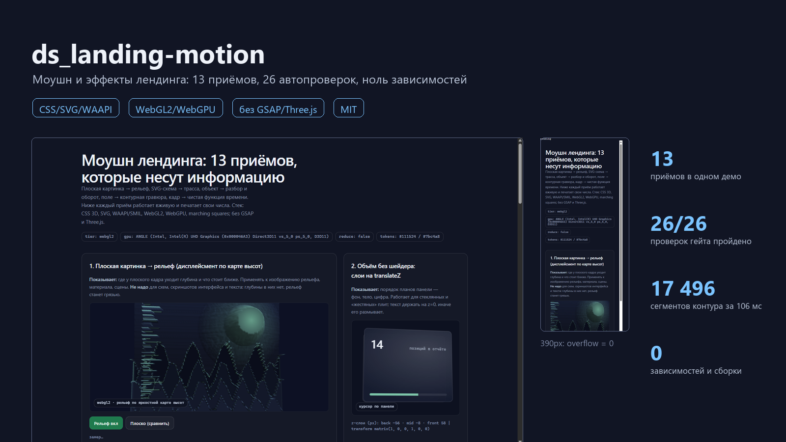
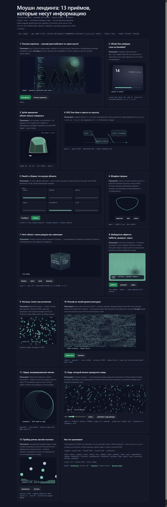
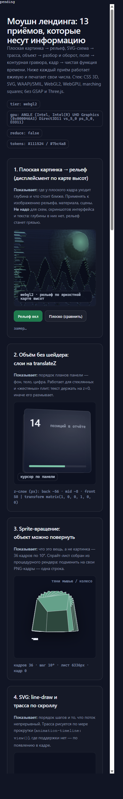

# ds_landing-motion — моушн и эффекты на лендинге



> **Скилл про движение, которое несёт информацию, и вкус, который его выбирает** — Victor Zaitsev / Discovery System
>
> Плоская картинка становится объёмом, схема оживает линией, заголовок собирается по буквам, объект разбирается и собирается, фон печатает halftone. Всё это — на чистом CSS, SVG, Web Animations API и WebGL2/WebGPU: без GSAP, Three.js, Anime.js и сборки. С живым демо, прогоном, который доказывает работу числами, и лупом самоаудита, по которому агент сам находит свои косяки и чинит их.

## Чем это отличается от «ещё одного набора анимаций»

Три вещи, которых нет в галереях и библиотеках компонентов:

1. **Мозг, а не свалка.** Скилл читает задачу (Design Read: тип страницы, аудитория, крутилки плотности/движения/композиции), выбирает приём по типу объекта, а не по вкусу, и знает, кто кого бьёт при конфликте: жёсткие запреты → каркас секции → тональность → внешние паттерны.
2. **Дисциплина агента.** Блок «Принятие задачи»: не переопределять задачу молча, не угадывать — спрашивать одним заходом, не расширять без запроса. Решает геморрой «агент не понял меня 7 раз подряд».
3. **Самоаудит-луп.** Механический цикл: автогейт → визуальный протокол → оценка восьми рычагов цифрами → пересборка 2–3 слабейших → повтор. Каждая проверка — число с порогом или греп, а не «на глаз». По циклу проходит модель любого уровня.

## Что внутри

- **SKILL.md** — тонкий роутер: когда грузить, что грузить, запреты, токены движения и цвета, порядок работы, «Принятие задачи», приоритет источников.
- **references/** — 16 тем с рабочим кодом, по одной за раз:
  - Приёмы: `object-to-3d.md` (PNG → объём, дисплейсмент по карте высот), `svg-motion.md` (line-draw, трасса по скроллу, морфинг, маски), `object-motion.md` (разлёт/сборка, ракурсы, хореография), `generative-effects.md` (WebGL2/WebGPU/canvas 2d, halftone, дизеринг, зерно, частицы), `hairline-contours.md` (контурная графика из поля), `model-3d-viewer.md` (настоящий GLB).
  - Вкус и текст: `design-read.md` (чтение брифа, крутилки V/M/D, анти-дефолт), `text-motion.md` (24 текстовых контракта с точными числами), `transitions-micro.md` (три яруса движения, View Transitions, магнитные кнопки, marquee).
  - Показ продукта: `faux-ui.md` (фейк-UI в кадре — hero-демо с курсором, bento с окном приложения: 5 провалов, крафт, фрейминг, моушн сцены; дистиллят Stageshow, MIT).
  - Доказательства: `verify-motion.md` (ловушки headless, гейт приёмки), `audit-foreign.md` (аудит чужого лендинга: DOM-пробник и пороги), `deterministic-motion.md` (воспроизводимое движение, скраб, скриншот-тест), `motion-rhythm-qa.md` (восемь рычагов ритма), `self-audit-loop.md` (луп самоаудита), `video-handoff.md` (передача движения в ролик).
- **demo/** — тринадцать приёмов на одной странице, каждый печатает свои числа; `measure.py` снимает прогон и выносит вердикт.
- **scripts/** — `motion_qa.py` (ритм по записи) и `seek-shim.js` (детерминированный сик).

## Доказательство: живой прогон, не обещания

Кадры ниже — не мокапы: это снимки `demo/index.html` из прогона `python demo/measure.py` (Chrome, Windows 11), лежат в [`docs/`](docs/). Полный отчёт с числами — [`docs/run_verify.json`](docs/run_verify.json).

| | |
|---|---|
|  |  |
| Полная страница: 13 приёмов на одной, каждый печатает свои числа | 390px: горизонтального переполнения нет |

Числа последнего прогона (из `docs/run_verify.json`):

- гейт **26/26 проверок пройдено**, ни одного пустого блока (порог видимости 2%);
- детерминизм: кадр 37 совпал по хешу **между двумя независимыми процессами Chrome** (`7f485e2`);
- контуры: **17 496 сегментов** за 106–140 мс, параллакс слоёв 5.2→26px монотонный;
- контраст токенов: ink/bg **16.2:1**, body/bg 10.2:1, faint/bg 4.9:1 (AA);
- reduce-ветка отдаёт финальное состояние, `overflowX = 0` на 1422 и на 390.

Воспроизвести у себя: `python demo/measure.py --shot-dir demo/_shots` — печатает таблицу и строку `ГЕЙТ: пройден` или список того, что не доказано.

## Быстрый старт

```bash
# 1. Демо: открыть demo/index.html двойным кликом (или file://) — ничего не собирается, сеть не нужна
# 2. Прогон с числами и кадрами:
python demo/measure.py --shot-dir demo/_shots
```

Прогон печатает 26 проверок (видимость блоков в живых пикселях, дисплейсмент, режимы печати, dashoffset, позы, поворот, покрытие частицами, `overflowX` на 1422 и 375, детерминизм — совпадение хеша кадра между двумя процессами Chrome) и заканчивается строкой `ГЕЙТ: пройден` — или списком того, что не доказано.

Ключи страницы: `?static=1` (без бесконечных циклов — для прогонов), `?final=1` (финальный кадр), `?tier=webgl2|canvas2d` (зафиксировать путь эффекта), `?reduce=1` (ветка reduce без эмуляции медиазапроса).

## Принципы, на которых собран скилл

- **Эффект обязан отвечать одной фразой «он показывает X».** Красивая картинка без информации и приём без смысла — одно и то же.
- **Только `transform` и `opacity`**, easing из токенов (`cubic-bezier(.22,1,.36,1)`), никаких bounce и elastic.
- **`prefers-reduced-motion: reduce` на каждый эффект** — с финальным состоянием, а не с пустотой.
- **Библиотека-тяжеловес не тянется туда, где хватает платформы.** Исключение — настоящая GLB-модель.
- **Ничего не объявляется работающим без прогона.** Числа из DOM и из пикселей, а не «выглядит норм».
- **Советы внешних скиллов не бьют запреты.** Если внешний референс советует фиолетовый неон — он отклонён, канон не трогают.

## Кто это сделал

Инструмент открытый и бесплатный — и останется таким: **ценность создаётся инструментом, а не замком на нём.** Копируйте, форкайте, встраивайте в свои лендинги. Замок на коде всё равно снимают за вечер; узнаваемость автора держится не на нём.

Что помогает автору — Telegram-канал с разборами, обновлениями и приёмами моушна: **[t.me/discoverysystem](https://t.me/discoverysystem)**. Там новые приёмы и обновления скилла выходят раньше, чем попадают сюда, и там быстрее отвечают на вопросы по настройке.

Если скилл сэкономил время — лучшая благодарность не звёздочка, а рассказ о нём тому, у кого та же задача.

## Лицензия

MIT — свободно, с атрибуцией. Полный текст — в [LICENSE](LICENSE).
